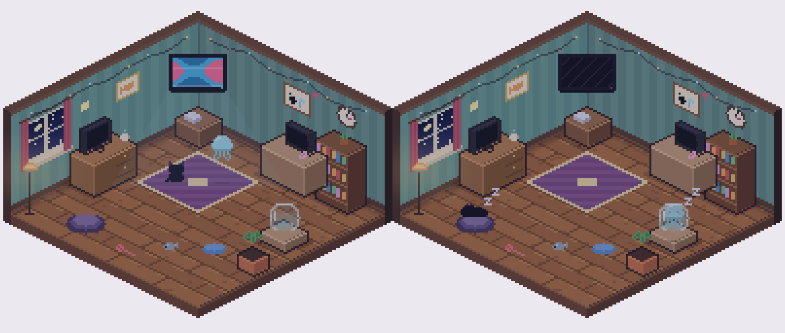
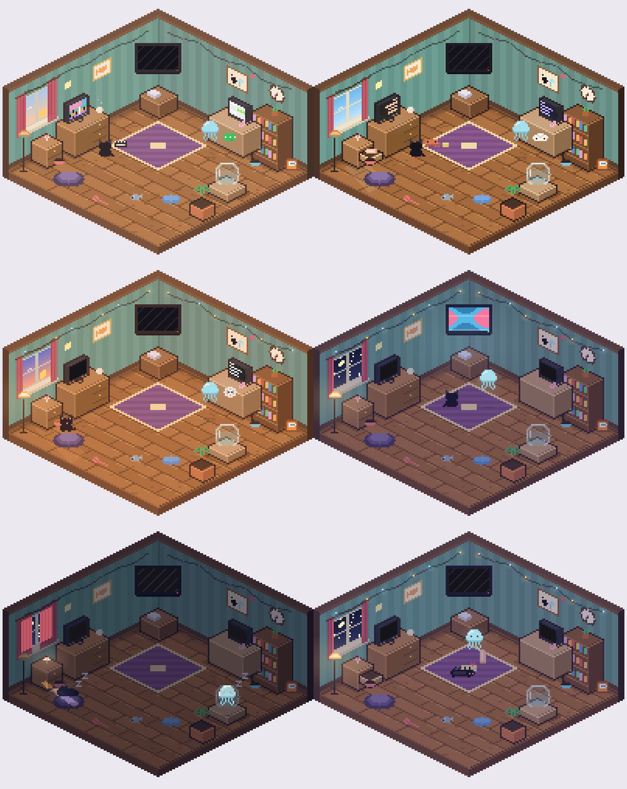

# JellyCat · 小水母和小黑猫

一间浮在桌面角落的像素小房间。🐈‍⬛ 小黑猫和 🪼 小水母住在里面，各忙各的：

- 你在和 Claude 干活，猫的桌边就来了一只小螃蟹在搭积木；TA 在和豆包聊天，水母旁边就飘着一个小豆包。
- 打游戏屏幕会闪，开会屏幕会变成会议格子，发呆五分钟就回窝睡觉（水母睡在圆鱼缸里）。
- 一起看同一个 B 站视频时，两只会挪到电视前，电视亮起来。进度同步：暂停一起暂停，卡一起卡。
- 房间跟着时间变：清晨、白天、黄昏、夜晚、深夜五个样子（深夜会拉上窗帘、只剩小夜灯和月光）。
- 剪映剪视频、回微信也会演出来。

**房间里能玩的：**

- **双击电视**：两个人的 Chrome 都打开 B 站，两只先去电视前等着；谁先播放一个视频满 3 秒，对方就自动打开同一个视频、同一个进度。
- **猫粮**：把墙角的猫粮袋拖到自己的小碗里，自己的小动物就去吃饭（告诉对方"我去吃饭了"）；吃完了点一下自己的小动物或者碗。
- **抽屉**：点床头柜的抽屉，里面有一根软软的硅胶棒。把它拖到水母身上，两只就到房间中间，小猫仰面躺着，水母抱着它慢慢捶（按摩）。点水母会变快，点小猫会冒舒服的表情，再点抽屉一切复原。
- **点自己**发消息（带一声很轻的"咕嘟"），**点 TA** 戳一下。
- **拖到屏幕左边或右边**：收起来，只剩两只从屏幕边上探出半个脑袋。点一下展开。
- 右键菜单里可以手动切换房间时间。

**小卖部：**

- 金币两个人一起用。每人每天上线 +10，两人当天都上线再 +10，每天每种行动 / 状态第一次 +1～3。
- 点房间右下角的金币打开小卖部：换地板、壁纸、书桌、电脑、书架、饭盆……还有装饰和节日套装（🎃 万圣节）。
- 点一件东西先在房间里预览，买了两个人的房间一起换。
- 房间分成 27 个位置（见 `desktop/src/catalog.mjs`），同一位置的东西互相替换，装饰位每个只放一件，不会冲突。

几乎不需要文字，只是知道"TA 也在"。





> 为异地恋的两个人做的。目前只支持 Mac，Windows 版本的代码已经写好但还没测。

## 安装

**Mac 一键安装：**

```bash
curl -fsSL https://raw.githubusercontent.com/cooooookai/jellycat/main/scripts/install-mac.sh | bash
```

也可以在 [Releases](https://github.com/cooooookai/jellycat/releases) 下载 zip：在访达里双击解压，拖进「应用程序」，然后在终端运行一次：

```bash
xattr -cr /Applications/JellyCat.app
```

（App 没有苹果付费签名，不运行这行 Mac 会说它"已损坏"。）

**让 AI 帮忙装：** 把这句话发给你的 AI 助手——

> 请读 https://github.com/cooooookai/jellycat/blob/main/AGENT_SETUP.md ，按里面的步骤帮我安装 JellyCat 并完成配对。

## 配对

两个人里**一个人生成配对码，另一个人粘贴**：

1. 生成的人：选好自己是猫还是水母 → 填服务器地址（或者两人在同一个 Wi-Fi 下时勾「这台电脑当服务器」）→ 点「生成配对码」，用微信发给 TA。
2. 粘贴的人：粘贴配对码 → 点「配对」。

## 服务器

服务器只负责在两个人之间传话，非常小。三种选择：

| 方式 | 适合 | 怎么做 |
|---|---|---|
| 这台电脑当服务器 | 两人在同一个 Wi-Fi 下 | 设置里勾一下就行 |
| Render 免费方案 | 异地，先免费试试 | [](https://render.com/deploy?repo=https://github.com/cooooookai/jellycat)，部署好后地址填 `wss://你的服务名.onrender.com` |
| 自己的服务器 / 闲置电脑 | 长期稳定使用 | `cd server && npm install && node server.js`，默认端口 8787 |

Render 免费方案没人在线 15 分钟后会休眠，下次打开要等几十秒醒来。

## Chrome 插件（一起看 B 站）

`chrome://extensions` → 打开「开发者模式」→「加载已解压的扩展程序」→ 选 `extension` 文件夹。桌面端开着的话插件会自动配好，不用填任何东西。

- 一键去 TA 那里：打开 TA 正在看的视频，跳到同一个进度
- 暂停、跳转、倍速、换集都会同步；一方缓冲另一方自动等
- 误差超过 1.5 秒自动拉齐

## 开发

```bash
cd desktop && npm install && npm start        # 桌面端
cd server && npm install && node server.js    # 中继服务器
```

在一台电脑上同时开"两个人"：

```bash
cd desktop
JC_PROFILE=./profile-cat npm start
JC_PROFILE=./profile-jelly npm start
```

打包：`npm run dist:mac`（在 Mac 上）。

### 结构

```
desktop/     Electron 桌面端：透明置顶的小房间
  src/room.js   像素房间渲染器（纯代码画出来的，主题在 THEMES 里）
  activity.js   识别前台程序（Win: PowerShell / Mac: osascript，不需要权限）
  relay.cjs     内置中继服务器（和 server/ 共用）
extension/   Chrome 插件：B 站同步播放
server/      中继服务器（WebSocket）
scripts/     安装脚本
```

### 想做的

- [ ] 节日主题房间：春节、圣诞、樱花季……（在 `THEMES` 里加一套）
- [ ] 更多 AI 住客、更多活动动画
- [ ] Windows 安装包
- [ ] 正式的像素美术

## 说明

房间里的 AI 住客用的是各家产品的代表色，只是为了好认，本项目与 Anthropic、OpenAI、Moonshot、字节跳动等公司均无关联。

[MIT License](LICENSE)
